# 例会プログラム作成ツール 操作手順書

版：v1.03（2026-11-08）

新宿バイリンガルトーストマスターズクラブの例会プログラム（PDF）を、クラブサポートシステムの内容から自動で作るツールの使い方です。Mac でも Windows でも、ブラウザだけで使えます。

## 全体の流れ

1. クラブ用のスプレッドシート（テンプレート）で「① 次回のプログラムを作成」を押す
2. できたプログラムを開いて確認し、必要なら手直しする
3. テンプレートに戻って「② 最新のプログラムを PDF 出力」を押す

所要時間は 1 回あたり数分です。初めて使うときだけ、Google の「承認」の手順があります（下の「1. 初めて使うとき」）。

> **使うスプレッドシート**：クラブの共有フォルダにある「template」という名前のスプレッドシートです。場所が分からない場合は、プログラム担当の役員に聞いてください。

---

## 1. 初めて使うとき（承認・1 回だけ）

このツールはクラブで作ったものなので、最初に一度だけ「このツールに自分の Google アカウントでの操作を許可する」手順が必要です。2 回目以降は表示されません。

### 1-1. メニューを開く

テンプレートを開くと、上のメニューの右端に「**例会プログラム**」が表示されます（表示されるまで数秒かかることがあります）。

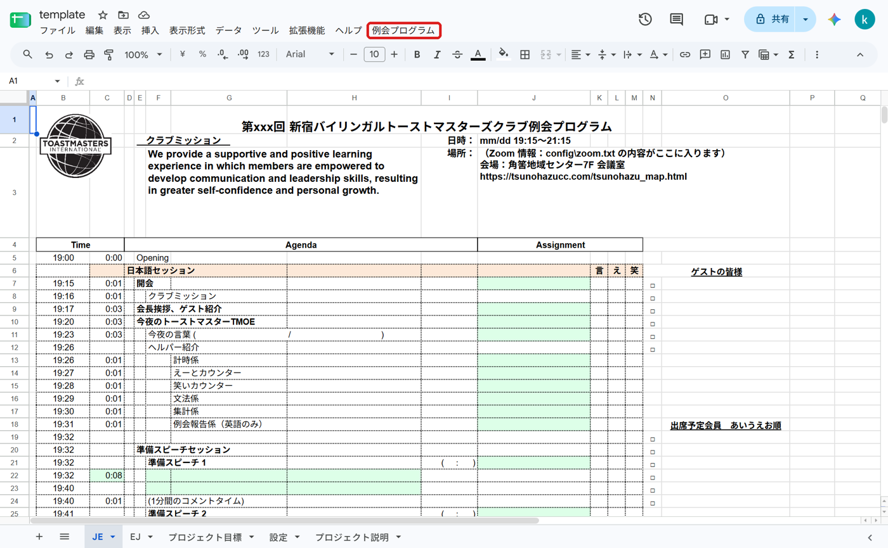

「例会プログラム」→「**① 次回のプログラムを作成**」を押します。

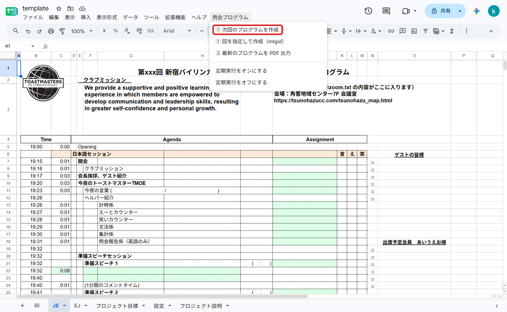

### 1-2. 「認証が必要です」→「OK」

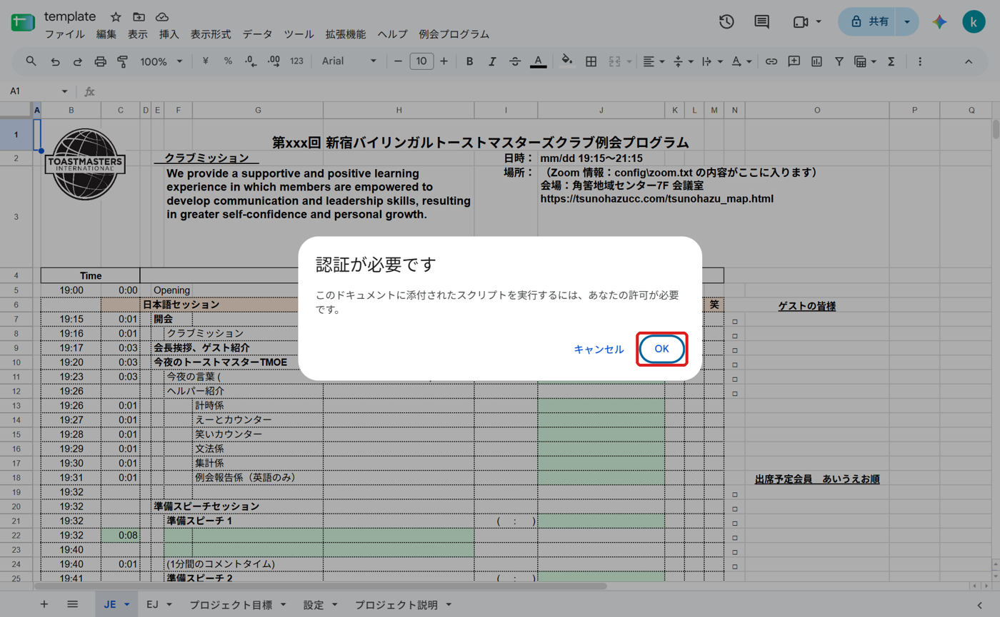

### 1-3. アクセスの許可

Google のログイン画面が別のウィンドウで開きます。アカウントを選ぶ画面が出た場合は、自分のアカウントを選んでください。

「**すべて選択**」にチェックを入れます。**チェックを入れないとツールが動きません。**

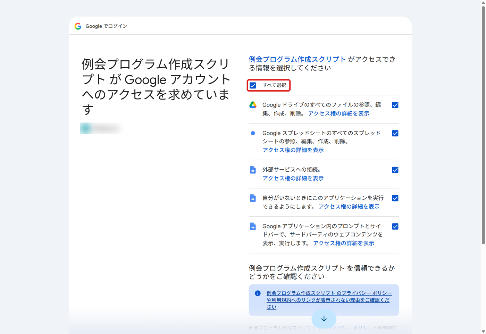

画面を下までスクロールして「**次へ**」（または「許可」）を押します。

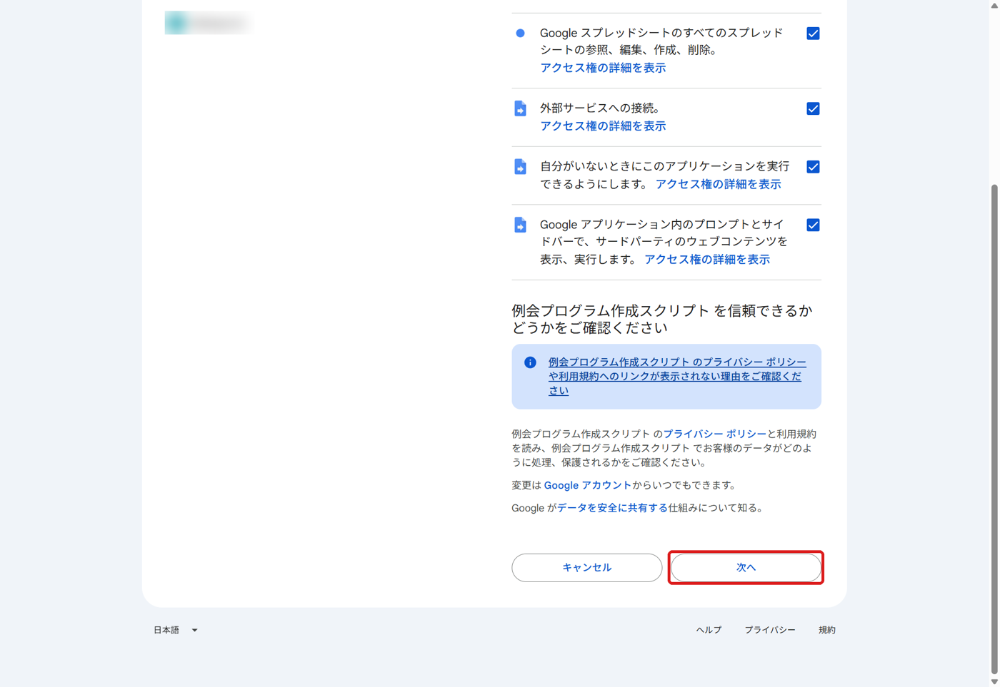

> **「このアプリは Google で確認されていません」と表示された場合**（個人の Gmail アカウントなど）
> 左下の「**詳細**」を押し、「**（安全ではないページ）に移動**」を押してから、上の手順に進んでください。クラブで作ったツールのため Google の審査を受けていない、という意味の表示で、問題はありません。

> **許可する内容について**：スプレッドシートとドライブのファイルの作成・編集（プログラムのコピーと PDF の保存）、外部サービスへの接続（クラブサポートシステムから役割などを読み込む）、自分がいないときの実行（定期実行を使う場合）です。

承認が終わると、そのまま次の「2. プログラムを作る」の確認画面に進みます。

> 承認の直後に何も起きなかった場合は、もう一度「例会プログラム」→「① 次回のプログラムを作成」を押してください。

---

## 2. プログラムを作る（①）

### 2-0. イベントがある回（入会式・ワークショップなど）は先に書いておく

入会式、ワークショップ、役員就任式、虎の穴、役員選挙、年間表彰などがある回は、① の前にテンプレートの「**イベント**」シートに 1 行ずつ書きます。イベントが無い回は何もしなくて構いません。

| 例会回 | イベント名 | 挿入位置 | 所要時間（分） | 担当者 |
|---|---|---|---|---|
| 386 | 入会式 | 会長挨拶・ゲスト紹介の後 | 15 | （空欄なら例会ページから） |

- **挿入位置**はプルダウンから選びます：会長挨拶・ゲスト紹介の後（入会式はふつうここ） / 前半スピーチの後 / 前半テーブルトピックの後 / 休憩の前 / 休憩の後 / 後半スピーチの後 / 後半テーブルトピックの後 / 表彰の前 / 閉会の前
- **担当者**は空欄で構いません。例会ページの役割（「入会式担当」など）から自動で入ります。
- 終わった回の行は残しておいても問題ありません（例会回が違う行は使われません）。

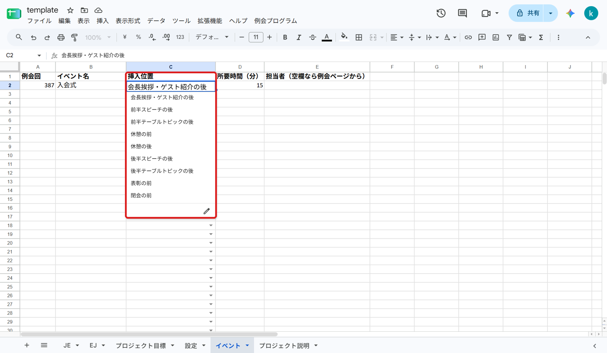

### 2-1. 「① 次回のプログラムを作成」を押す

テンプレートで「例会プログラム」→「① 次回のプログラムを作成」を押すと、次回の例会の日付と回が表示されます。正しければ「**OK**」を押します。

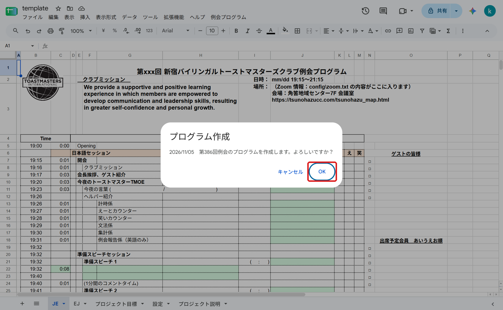

### 2-2. 「作成しました」

数十秒で「作成しました」が表示されます。

- **保存先**：プログラムを保存したフォルダです。クラブの共有フォルダになっているか確認してください。
- **注意**：足りない情報などがあれば表示されます（下の「5. 困ったとき」）。
- 「**開く**」を押すと、できたプログラムが開きます。

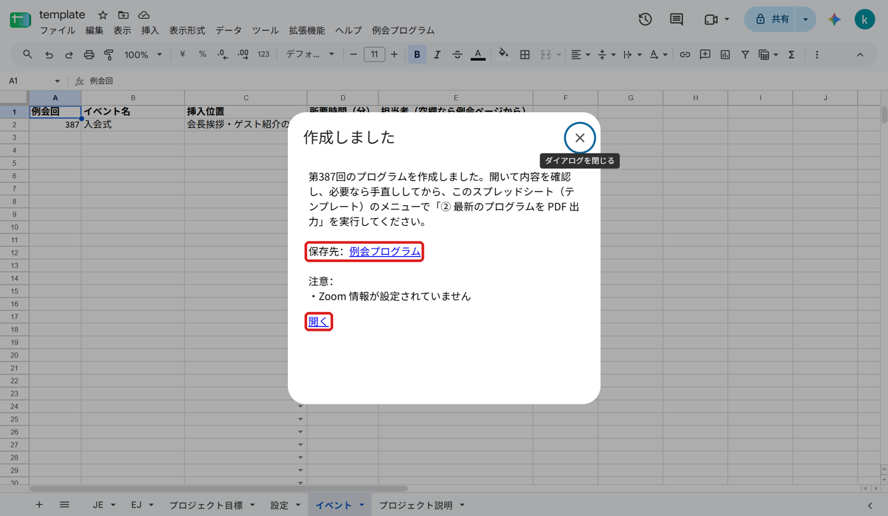

### 2-3. 内容を確認する

できたプログラム（「新宿BTMC第○回例会プログラム○○○○」という名前のスプレッドシート）が開きます。役割・スピーチ・ゲスト・出席予定会員が入っています。下のシート「プロジェクト目標」には、スピーチのプロジェクトの説明が入っています。

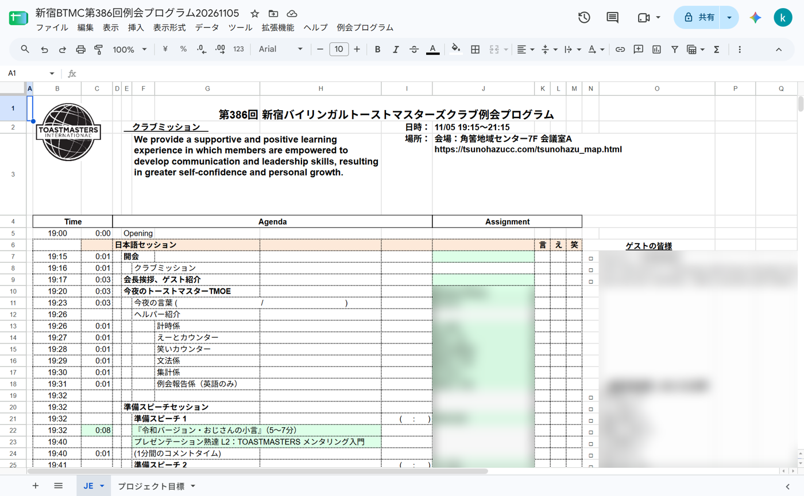

「イベント」シートに書いた回は、指定した位置にイベントの行が入り、その後の時刻が自動でずれます。

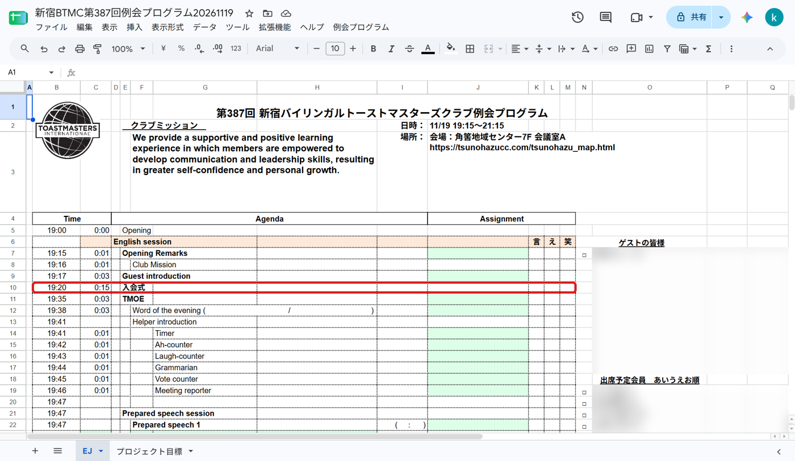

---

## 3. 手直しする（必要なときだけ）

欠席や役割の変更があったときは、できたプログラムのセルを直接書き換えてください。普通のスプレッドシートと同じように編集できます。

- **B 列（開始時刻）は数式なので書き換えないでください。** C 列（所要時間）を変えると、B 列の時刻は自動で計算し直されます。
- プロジェクトの説明が入っていないときは、「プロジェクト目標」シートに貼り付けることができます。
- 終了予定が 21:15 を過ぎる回は、自動で時間が調整されています。順番は、テーブルトピック（各セッション 2 人まで）→ 休憩（最短 5 分）→ 総合論評（最短 5 分）です。減らしたテーブルトピックの行は非表示になっているだけなので、戻すときは行番号の間をクリックして再表示し、C 列（所要時間）を 0:03 に戻してください。

---

## 4. PDF にする（②）

### 4-1. テンプレートで「② 最新のプログラムを PDF 出力」を押す

**テンプレート**（template）に戻り、「例会プログラム」→「**② 最新のプログラムを PDF 出力**」を押します。

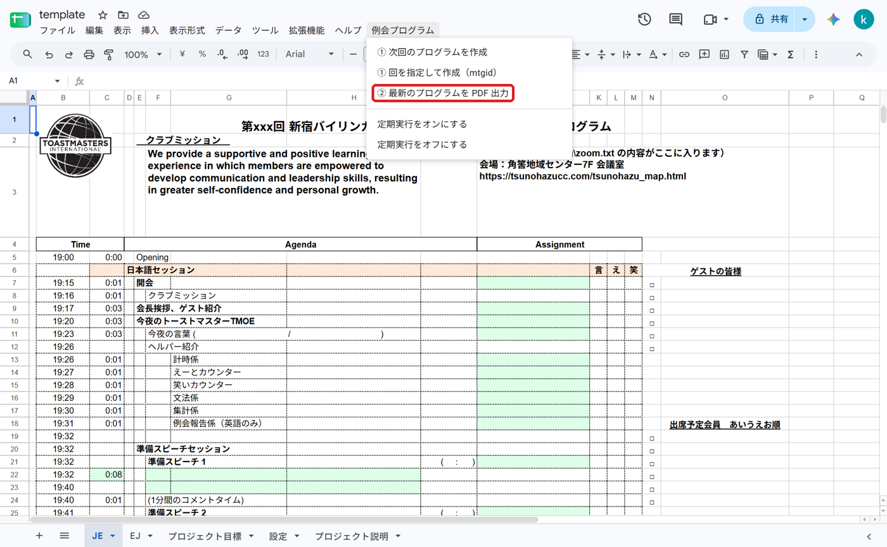

### 4-2. PDF にするプログラムを確認して「OK」

いちばん最近作成・手直ししたプログラムの名前が表示されます。正しければ「**OK**」を押します。手直しした内容もそのまま PDF になります。

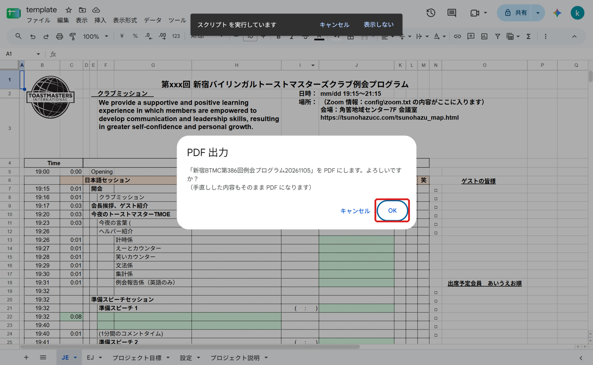

### 4-3. 「PDF を保存しました」

「開く」を押すと PDF を確認できます。

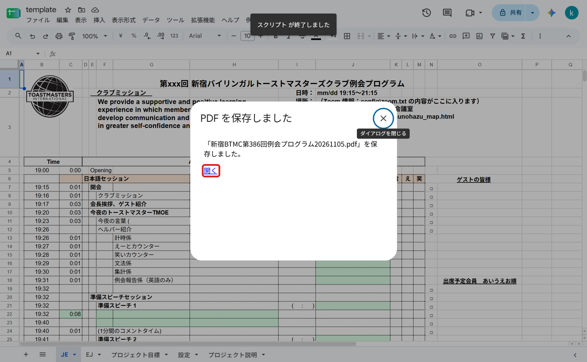

PDF は、プログラムと同じフォルダに保存されます。

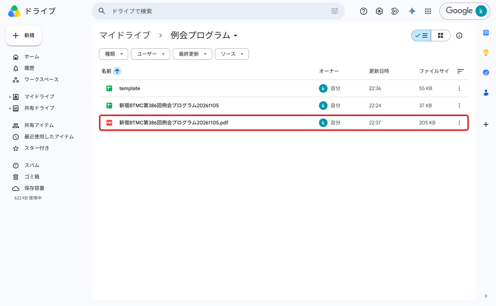

### 別の方法：できたプログラムから PDF にする

できたプログラムを開いているときは、そのプログラムのメニュー「例会プログラム」→「**このプログラムを PDF 出力**」でも PDF にできます。古い回のプログラムを PDF にし直したいときなどに使います。

> **注意**：この方法は、プログラムのファイルごとに、初めて使うときに「1. 初めて使うとき」と同じ承認の手順が出ます。毎回の承認が面倒な場合は、テンプレートの「② 最新のプログラムを PDF 出力」を使ってください（こちらは承認不要です）。

---

## 5. 困ったとき

| 表示・状況 | 対処 |
|---|---|
| メニューに「例会プログラム」が出ない | ページを再読み込み（F5 / ⌘R）して、数秒待つ |
| できたプログラムのメニューに ① や ② が無い | 正常です。できたプログラムには「このプログラムを PDF 出力」だけが出ます。① と ② はテンプレートで使います |
| 注意「プロジェクト「○○」の説明が見つかりません」 | 見出しだけが入っています。必要なら「プロジェクト目標」シートに説明を貼り付ける |
| 注意「終了予定が ○○ になるため調整しました」 | 終了予定が 21:15 を過ぎるため、テーブルトピック・休憩・総合論評を自動で調整しました。内容を確認する（戻し方は「3. 手直しする」） |
| 注意「終了予定が ○○ で、21:15 を過ぎています」 | 自動の調整だけでは収まりません。テーブルトピックを日英どちらかにするなど、TMOE と相談してスプレッドシートで時間を手直しする |
| 注意「例会ページに「入会式担当」…がありますが、「イベント」シートにありません」 | 「イベント」シートに書いてから、① をやり直す（古いファイルは削除） |
| 注意「Zoom 情報が設定されていません」 | テンプレートの「設定」シートの B1 が空です。管理者に連絡する（下の「6. 管理者向け」） |
| 次回以外の回を作りたい | 「① 回を指定して作成（mtgid）」を使い、例会詳細ページの URL の `mtgid=` の後ろの数字を入れる |
| ① をやり直したら同じ名前のファイルが 2 つになった | 古い方を削除する。② は最後に更新した方を PDF にする |
| 保存先が自分のドライブになっている | 管理者に連絡する（「設定」シートの B2 を確認） |
| エラーが表示された | 表示された文を控えて、管理者に連絡する |

### 定期実行（任意）

「定期実行をオンにする」を押すと、毎週木曜 13 時台に、その日が例会日ならプログラムを自動で作成します（PDF は自動では作りません）。オンにした人のアカウントで動き、オフにできるのもその人だけです。通常はオフのままで構いません。

---

## 6. 管理者向け：設定シート

テンプレートの「**設定**」シートに次の内容を入れます。

- **B1**：Zoom の URL・ID・パスコード（セルをダブルクリックしてから貼り付けると、複数行のまま 1 つのセルに入ります）
- **B2**：通常は空欄（テンプレートと同じフォルダに保存されます）。別のフォルダに保存したいときだけ、そのフォルダの URL を入れる

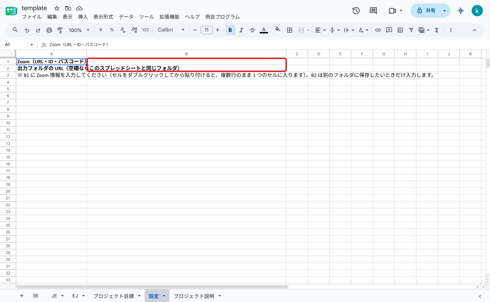

テンプレートの準備（初期設定）やスクリプトの更新の方法は、[README](../../README.md) を参照してください。

---

## 更新履歴

| 版 | 日付 | 内容 |
|---|---|---|
| v1.00 | 2026-11-02 | 初版 |
| v1.01 | 2026-11-07 | イベント（入会式・ワークショップなど）の追加方法（2-0）、終了予定が 21:15 を過ぎるときのテーブルトピックの自動調整、「作成しました」画面の画像を更新、「困ったとき」に項目を追加 |
| v1.02 | 2026-11-08 | イベントの挿入位置に「会長挨拶・ゲスト紹介の後」を追加、終了予定の調整を「テーブルトピック → 休憩 → 総合論評」の順に変更（テーブルトピックは通常 2 人ずつ残る） |
| v1.03 | 2026-11-08 | 記入例の入会式の挿入位置を「会長挨拶・ゲスト紹介の後」に変更、画像を差し替え、終了予定の自動調整でテーブルトピックを各セッション 2 人より減らさないように変更（それ以上は TMOE が判断） |
